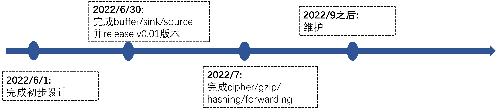
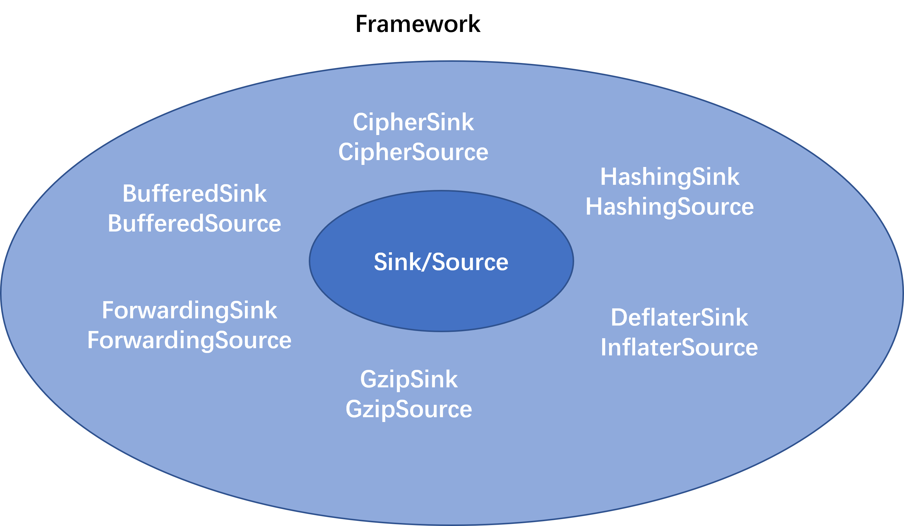
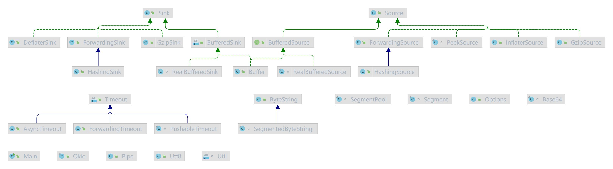

<div align="center">
<h1>io4cj</h1>
</div>

<p align="center">


</p>

## 介绍

io4cj是HttpClient的底层IO库，io4cj是对仓颉io库的补充，使访问、存储和处理数据变得更加容易。核心概念是source和sink，分别类似于仓颉的InputStream和OutputStream。

### 特性

- 🚀 buffer

- 💪 cipher

- 💪 hashing

- 💪 forwarding

- 💪 gzip

- 💪 deflate/inflate

### 路线

<p align="center">

</p>


##     架构

### 架构图

<p align="center">

</p>
<p align="center">

</p>


### 源码目录

```shell
.
├── README.md
├── doc
│   ├── assets 
│	├── cjcov 
│   ├── design.md  
│   └── feature_api.md
├── src
│ 	├── asyncTimeout.cj
│	├── buffer.cj
│ 	├── buffered_sink.cj
│	├── buffered_source.cj
│ 	├── byte_string.cj
│	├── deflater_sink.cj
│ 	├── exception.cj
│	├── forwarding_sink.cj
│ 	├── forwarding_source.cj
│	├── forwarding_timeout.cj
│ 	├── gzip_sink.cj
│	├── gzip_source.cj
│ 	├── hashing_sink.cj
│	├── hashing_source.cj
│	├── inflater_source.cj
│ 	├── okio.cj
│	├── PeekSource.cj
│ 	├── pipe.cj
│	├── pushable_timeout.cj
│ 	├── RealBufferedSink.cj
│	├── RealBufferedSource.cj
│ 	├── segment_pool.cj
│	├── segment.cj
│ 	├── sink.cj
│	├── SocketStream.cj
│ 	├── source.cj
│	├── timeout.cj
│ 	├── utf8.cj
│	└── util.cj
└── test   
│   ├── HLT
│   ├── LLT
│   └── UT
├── CHANGELOG.md
├── LICENSE.txt
├── .gitignore
├── README.md
└── README.OpenSource
```

- `doc`是库的设计文档、库的使用文档 、LLT 覆盖率报告(1. io4cj 中存在包内可见的私有实现类, 成员函数调用之间都是包内可见函数, 外部LLT测试用例调用不到 2. io4cj中开启spawn时 LLT测试用例覆盖不到.  导致覆盖率未达到90%. )
- `src`是库源码目录
- `test`存放 HLT 测试用例、LLT 自测用例和 UT 单元测试用例

### 接口说明

主要是核心类和成员函数说明，详情见 [feature_api](./doc/feature_api.md)

## 使用说明

### 编译

两种编译方式

1. 使用脚本编译 
    1. 下载配置[编译脚本](https://gitcode.com/Cangjie-TPC/TPC-Test-Framework.git)
    2. ciTest build
2. 使用cjpm编译 
    1. 该三方库依赖stdx，请参考[stdx](https://gitcode.com/Cangjie/Cangjie-STDX#%E4%BD%BF%E7%94%A8%E6%8C%87%E5%AF%BC)文档配置`CANGJIE_STDX_PATH`路径
    2. cjpm build


## 功能示例
```cangjie
import std.io.*
import std.time.*
import std.fs.*
import io4cj.*
main() {
    var file = File("demo.txt", OpenOption.Create(true))
    Okio.buffer(Okio.sink(file))
        .writeUtf8("abcdefghijklmn \n")
        .writeUtf8("中国 \n")
        .writeUtf8("1234")
        .close();

    file = File("demo.txt", OpenOption.Open(true, true))
    let bufferedSource = Okio.buffer(Okio.source(file));
    println(bufferedSource.readUtf8Line())
    println(bufferedSource.readUtf8Line())
    println(bufferedSource.readUtf8Line())
}
```

##### 执行结果如下：

```shell
abcdefghijklmn 
中国 
1234
```

#### 文件拷贝示例

```cangjie
import std.io.*
import std.time.*
import io4cj.*
main() {
    let a = Time.now().unixNano() / 1000000  // 计算开始时间
    let file = File("apache-tomcat-8.5.81.rar", Read, Open)
    let bs = ByteString.read(file, file.length)
    var file2 = File("apache-tomcat-8.5.81-2.rar", Write, ForceCreate)
    bs.write(file2)
    let b = Time.now().unixNano() / 1000000  // 计算结束时间
    println(b)
    println(a)
    println(b-a)
}
```
#### 执行结果如下: 
```shell
1663827401063
1663827401032
31
```

在下述版本验证通过：
```shell
Cangjie Version: 1.2.0
```

## 开源协议

本项目基于 [Apache License 2.0](/LICENSE) ，请自由的享受和参与开源。

##  参与贡献

欢迎给我们提交 PR，欢迎给我们提交 issue，欢迎参与任何形式的贡献。